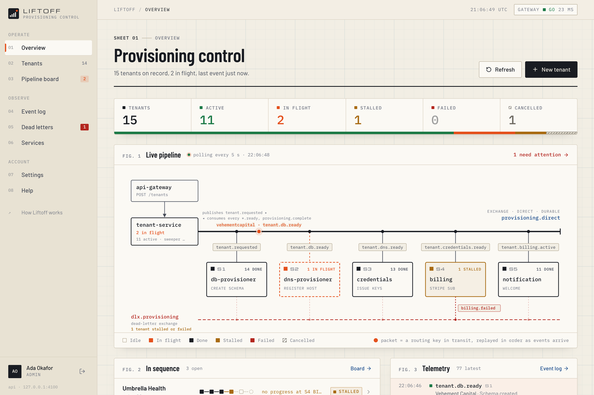
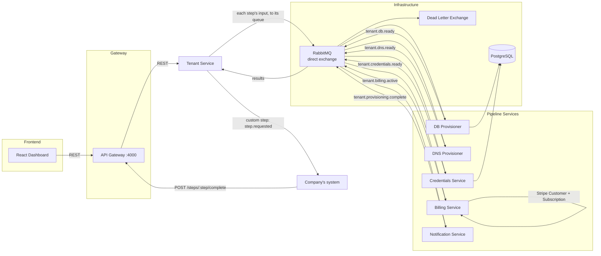
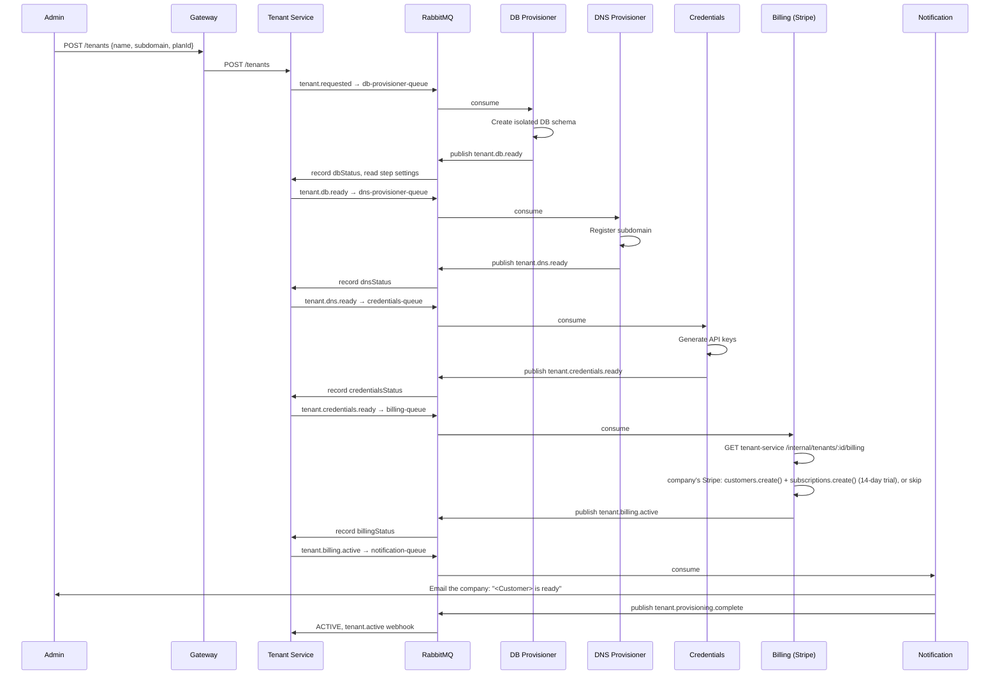
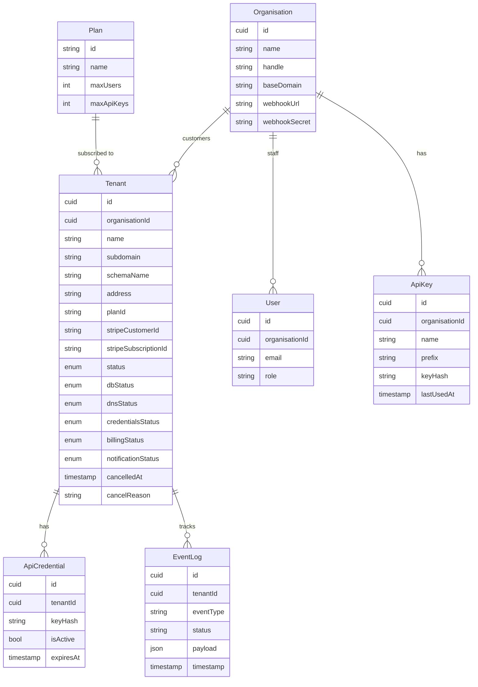

# TenantOps — Multi-Tenant SaaS Provisioning Platform

[](https://github.com/Olayanju-1234/liftoff/actions/workflows/ci.yml)

A production-grade microservices platform that automates the full lifecycle of tenant provisioning through an event-driven pipeline. Built to demonstrate distributed systems design, Stripe billing integration, and an orchestrated saga whose steps are pluggable: each one runs on Liftoff, is skipped, or is handed to the company's own system.

**Who it is for:** a SaaS company signs up as an **organisation**. Its customers are the **tenants** it provisions, by hand from the dashboard or from its own backend with a **company API key**. When a tenant is ready (or fails) Liftoff POSTs a signed **webhook** to the company. Any of the five steps can be a **custom step** that runs on the company's own infrastructure: Liftoff calls its URL and waits for a callback. See [Integrate](#integrate).

**[Live dashboard](https://liftoff.ojusentinel.com)** · [API docs](https://api.liftoff.ojusentinel.com/api/docs) · all seven services, RabbitMQ and PostgreSQL on one 1-vCPU ARM VPS behind nginx

**At a glance:** 7 NestJS services · RabbitMQ saga orchestrated by tenant-service, with a dead-letter exchange · per-step builtin / skipped / custom (the company's URL, signed, with a callback and a deadline) · schema-per-tenant PostgreSQL · Stripe customers and subscriptions with 14-day trials · stuck-pipeline sweeper · ADRs for the outbox pattern and Render vs AWS



## Table of Contents

- [System Architecture](#system-architecture)
- [Services](#services)
- [Event-Driven Pipeline](#event-driven-pipeline)
- [Data Model](#data-model)
- [Auth and Security](#auth-and-security)
- [API Reference](#api-reference)
- [Integrate](#integrate)
- [Getting Started](#getting-started)
- [Deployment](#deployment)
- [Engineering Decisions](#engineering-decisions)
- [Testing](#testing)
- [Roadmap and Known Gaps](#roadmap-and-known-gaps)

---

## System Architecture



---

## Services

| Service | Port | Description |
|---------|------|-------------|
| api-gateway | 4000 | Single entry point — rate limiting, routing, auth forwarding |
| tenant-service | 3001 | Core orchestration — tenant CRUD, pipeline state tracking |
| db-provisioner-service | 3002 | Creates isolated PostgreSQL schema per tenant |
| credentials-service | 3003 | Generates and stores API keys per tenant |
| dns-provisioner-service | 3004 | Registers subdomain DNS records |
| billing-service | 3005 | Subscribes the tenant in the company's own Stripe account (14-day trial), or records the step as SKIPPED |
| notification-service | 3006 | Emails the company "<Customer> is ready" / "needs attention" and publishes provisioning.complete |

### API Gateway

Single entry point for all client requests. Applies rate limiting (100 req/min per IP, stricter on auth routes), logs all traffic via Pino, and proxies to downstream services.

### Tenant Service

Core orchestration service. Manages the provisioning state machine and decides what runs next: when a step is due it reads the organisation's step settings and either sends the step's input straight to that worker's queue (builtin), marks it `SKIPPED` and moves on (skipped), or POSTs `step.requested` to the company's URL and waits for its callback (custom; see step 4 of [Integrate](#integrate)). Workers only report results; none listens to another's. It also consumes the dead-letter exchange: a rejected step marks that step and the tenant `FAILED`. A step that stays `IN_PROGRESS` with no change for 2 minutes is failed the same way (every minute; reason "Step timed out: …", `tenant.failed` webhook), and a sweeper every 5 minutes cancels any pipeline still `PROVISIONING` after 30 minutes as the backstop.

Provisioning states: `PROVISIONING → ACTIVE | FAILED | CANCELLED`, then `→ DEPROVISIONING → DELETED` on removal

Removal (`DELETE /tenants/:id`, or `POST /tenants/:id/cancel` from `ACTIVE`/`FAILED`) is a second, smaller saga. tenant-service sets the tenant `DEPROVISIONING`, stops any provisioning step still open, and publishes `tenant.deprovision`. db-provisioner drops the schema (`DROP SCHEMA IF EXISTS … CASCADE`, only names matching `tenant_*`, and never a schema another live tenant shares), credentials-service deletes the tenant's key, and billing-service cancels the Stripe subscription in the company's account when there is one. Each answers `tenant.deprovision.done`; tenant-service records it in `teardownDbStatus` / `teardownCredentialsStatus` / `teardownBillingStatus`, and whichever result lands last moves the tenant to `DELETED` (soft: `deletedAt` is set, the row and its events stay, it leaves `GET /tenants`) and sends the `tenant.deleted` webhook. A test tenant reads `DELETED` at once and is cleaned up in the background. Every teardown is idempotent, so a replayed message or a second `DELETE` is safe; a teardown that dead-letters reads `FAILED` and `DELETE` again retries it. A deleted tenant gives its name and subdomain back once its schema is gone (`Tenant.live` becomes null, which the per-organisation unique indexes ignore).

Removal follows how each step ran. A step that ran **custom** is torn down by the company's system: tenant-service POSTs `step.teardown` to the step's URL (signed, with its own `callbackUrl` ending in `/teardown` and a deadline) and the workers are given nothing to drop for it. Its teardown column (database, credentials, billing) mirrors the company's answer, and address and welcome, which have no column, hold the removal the same way: the tenant becomes `DELETED` only when every builtin part and every custom teardown is done. A step that was **skipped** has nothing to tear down (`SKIPPED`). A failed or timed-out custom teardown leaves the tenant `DEPROVISIONING`; `DELETE` again sends a new `step.teardown`.

Step statuses: `PENDING → IN_PROGRESS → SUCCESS | FAILED | CANCELLED | SKIPPED` (`SKIPPED` is billing on a test tenant or without Stripe, or any step the company set to skipped)

Steps never move backwards: tenant-service marks a step `IN_PROGRESS` only while it is still `PENDING`, so a replayed or duplicate result never starts a step twice. `Tenant.stepModes` records how each step ran (`builtin`, `skipped` or `custom`), and each custom request is a `CustomStepCall` row with its URL, deadline, outcome and the company's output.

### Billing Service

Consumes `billing-queue`, where tenant-service sends the `tenant.credentials.ready` payload when billing is due and builtin. Billing is never simulated. The company connects its own Stripe account with `PUT /organisation {"stripeSecretKey": "sk_…", "stripePrices": {"starter": "price_…", …}}` (Settings → Billing in the dashboard); the key is stored AES-256-GCM encrypted with `ORG_SECRETS_KEY` and never returned (`stripeConfigured: true` instead). For each tenant, billing-service fetches that configuration from tenant-service's internal API (`GET /internal/tenants/:id/billing`, authenticated with the shared `INTERNAL_API_TOKEN`, so the key never travels through RabbitMQ), creates a Stripe Customer and a Subscription with a 14-day trial on the price mapped to the tenant's plan, and publishes `tenant.billing.active` with the real ids, which tenant-service stores on the tenant. With no Stripe connected, or for a test tenant, it publishes `skipped: true` with a `skipReason` and the step is recorded as `SKIPPED`: the dashboard then says "Billing: not connected".

### Notification Service

Consumes `notification-queue` (the `tenant.billing.active` payload, sent by tenant-service when the welcome step is due and builtin) and emails **the company**, not the customer: "<Customer> is ready", with the address and plan and a link to the customer page. Recipients are the organisation's users with a verified email and *Email notifications* on. It then publishes `tenant.provisioning.complete` with `notification: { sent, recipients, skipReason? }`; tenant-service records the step as `SUCCESS` or, when nothing was sent (no provider, nobody to send to), `SKIPPED`, and the tenant goes `ACTIVE` either way. It also subscribes to `tenant.failed`, which tenant-service publishes whenever a step is marked `FAILED`, and emails "<Customer> needs attention" with the step and the error to the users with *Failed provisioning alerts* on.

The customer-facing welcome is the company's job: the `tenant.active` webhook carries the tenant, its address and plan, so the company's own product sends the welcome in its own voice.

---

## Event-Driven Pipeline



A step set to **skipped** is marked `SKIPPED` and the next one is sent at once. A step set to **custom** goes to the company instead of a worker: tenant-service records a request, POSTs `step.requested` to the company's URL (signed, retried) and moves on when the company calls `/complete`, or fails the step on `/fail`, a rejected request, or the deadline.

### Message Broker Configuration

- Exchange: `provisioning.direct` (direct, durable)
- Dead letter exchange: `dlx.provisioning` (durable)
- Worker step queues are not bound to the exchange: tenant-service publishes each step's input to the queue through the default exchange, and on every connect removes the bindings older versions left (`tenant.requested → db-provisioner-queue`, `tenant.db.ready → dns-provisioner-queue`, …)
- Each worker queue dead-letters to `dlx.provisioning` with its own key (`db-provisioner.failed`, `billing.failed`, …)
- tenant-service binds two durable queues to every key: `provisioning.dead-letters`, an unconsumed parking lot for inspection, and its own consumer queue, which marks the step and tenant `FAILED`. A failed step is replayed with `POST /tenants/:id/retry` (the Retry button in both dashboard views). See [docs/dead-letters.md](docs/dead-letters.md)
- `prefetchCount: 10` on all consumers

### Shared Event Types

Defined in `packages/shared-types` and consumed by all services:

```typescript
interface TenantRequestedPayload   { tenantId; subdomain; planId }
interface TenantDbReadyPayload     { tenantId; subdomain; planId }
interface TenantDnsReadyPayload    { tenantId; subdomain; planId }
interface TenantCredentialsReadyPayload { tenantId; subdomain; planId }
interface TenantBillingActivePayload {
  tenantId; subdomain; planId;
  stripeCustomerId: string | null; stripeSubscriptionId: string | null;
  subscriptionStatus; trialEnd: string | null;
  skipped?: boolean; skipReason?: 'test' | 'not-connected';
}
interface ProvisioningCompletePayload {
  tenantId; subdomain;
  notification?: { sent: boolean; recipients: number; skipReason?: 'no-provider' | 'no-recipient' | 'not-configured' };
}
interface TenantFailedPayload { tenantId; step; error }   // tenant-service → notification-service, "<Customer> needs attention"
```

---

## Data Model



---

## Auth and Security

- JWT with `sub`, `email`, `role`, `organisationId` claims (plus a legacy `tenantId`)
- Company API keys: `lk_…`, 32 random bytes, stored as a SHA-256 hash, shown once
- Webhooks signed with HMAC-SHA256; destinations resolved and checked against private, loopback, link-local and metadata ranges on every delivery
- bcrypt password hashing
- Email verification on signup and single-use, hashed, 1-hour password reset tokens; the forgot-password route answers the same whether or not the email exists
- Single-use refresh token rotation
- Rate limiting per IP at gateway level
- CORS with configurable origin whitelist
- Helmet security headers
- `class-validator` decorators on all DTOs

```typescript
// JWT payload shape
{
  sub: string;       // user ID
  email: string;
  role: 'ADMIN' | 'USER';
  organisationId: string | null;
  tenantId: string | null; // legacy workspace tenant; null for new accounts
}
```

---

## OpenAPI

Both `api-gateway` and `tenant-service` expose interactive Swagger UI at
`/api/docs` (e.g. `http://localhost:4000/api/docs`). The spec is generated
from `class-validator` decorators on the shared DTOs in
`packages/shared-types`, so request schemas stay in lockstep with runtime
validation.

## API Reference

### Auth

| Method | Endpoint | Description |
|--------|----------|-------------|
| POST | `/auth/register` | Sign a company up: creates the admin user and their organisation (`companyName`, `handle`), and emails a verification link (24 h). Provisions nothing |
| POST | `/auth/verify-email` | Verify the signup email with the `token` from the link (single use). Until then `POST /api-keys` answers 403 |
| POST | `/auth/resend-verification` | Send the signed-in user a new verification link |
| POST | `/auth/forgot-password` | Email a password reset link, valid 1 hour. Always 200 with the same message, so it never reveals whether an email has an account |
| POST | `/auth/reset-password` | Set a new password with the `token` from the link. Single use; signs every session out |
| POST | `/auth/login` | Login and receive tokens |
| POST | `/auth/refresh` | Refresh access token |
| POST | `/auth/logout` | Invalidate refresh token |
| GET | `/auth/me` | Get current user |

### Organisation and API keys

The organisation is the company that signed up. Every user in it sees the same tenants and keys.

| Method | Endpoint | Description |
|--------|----------|-------------|
| GET | `/organisation` | Name, handle, `baseDomain`, `webhookUrl`, whether a signing secret exists, and `limits` (`maxActiveTenants`, `maxProvisionsPerDay`) |
| PUT | `/organisation` | Update `name`, `baseDomain` or `webhookUrl`. `baseDomain` (e.g. `acme.app`) is what tenant addresses are shown under; `null` clears it. A new webhook URL (or `rotateWebhookSecret: true`) returns `webhookSecret` once; `webhookUrl: null` turns deliveries off. Private and loopback URLs get 400 |
| POST | `/api-keys` | Create a key (`name`). The response is the only place the key appears. 403 until the caller's email is verified |
| GET | `/api-keys` | List keys: id, name, prefix, last use. Never the key |
| DELETE | `/api-keys/:id` | Revoke a key (204) |

### Tenants

Tenants are the organisation's customers. `POST /tenants` files the new tenant under the caller's organisation (and records the user who clicked, when there is one). Every tenant endpoint only returns or changes that organisation's tenants: another company's tenant answers 404, so its ID can't be probed.

Test mode: `POST /tenants` with `"test": true` provisions the tenant like any other (schema, address, API key, webhook) but the billing step is `SKIPPED` and never calls Stripe, the tenant carries `isTest: true`, it is excluded from the quotas, and it can be deleted at any time.

Quotas: an organisation may have 10 active tenants (`PROVISIONING` or `ACTIVE`) and start 50 per rolling 24 hours by default (`Organisation.maxActiveTenants` / `maxProvisionsPerDay`, raised by hand in SQL). Over either, `POST /tenants` answers 429 with a message naming the limit and a `Retry-After` header. Provisions are counted in `ProvisionLog`, so deleting tenants does not reset the daily count.

`name` and `subdomain` are unique per organisation, not across the platform: two companies can both have an "acme". Every tenant in a response carries `address`, `<subdomain>.<baseDomain>` when the organisation has set one and `<subdomain>.liftoff.ojusentinel.com` otherwise (display only; DNS is simulated), and `schemaName`, the Postgres schema db-provisioner created: `tenant_<handle>_<subdomain>` for tenants created since org scoping, `tenant_<subdomain>` for older ones.

`POST /tenants`, `GET /tenants/:id` and the custom step callbacks also accept a company API key, as `x-api-key: <key>` or `Authorization: Bearer <key>`. Every other route needs a signed-in user.

| Method | Endpoint | Description |
|--------|----------|-------------|
| GET | `/tenants` | List the organisation's tenants |
| POST | `/tenants` | Create tenant and start provisioning (user token or API key; 10/min per IP). Send an `Idempotency-Key` header to make retries safe: the first response is stored per organisation for 24 h and replayed on a repeat (`Idempotent-Replayed: true`); the same key with a different body gets 422 |
| GET | `/tenants/:id` | Get tenant with step statuses (user token or API key; 60/min per IP) |
| DELETE | `/tenants/:id` | Remove a tenant: drop its schema, revoke its key, cancel its Stripe subscription; `DEPROVISIONING`, then `DELETED` (soft) and the `tenant.deleted` webhook. Again on a stuck removal retries it |
| POST | `/tenants/:id/retry` | Run the failed step of a `FAILED` tenant again, by the step settings as they are now: a builtin step's input message goes straight back to that worker's queue (payload from the event log, or rebuilt from the tenant), a custom step gets a new `step.requested`, a step switched to skipped is skipped. The tenant reads `PROVISIONING`, finished steps are kept. 400 unless `FAILED`, 409 if it changed meanwhile |
| POST | `/tenants/:id/steps/:step/complete` | Custom step callback (API key or user token): the step is `SUCCESS` and the next starts. Body `{ requestId?, output? }` |
| POST | `/tenants/:id/steps/:step/fail` | Custom step callback: the step and tenant are `FAILED` with your `{ error }`. Both callbacks are idempotent (`outcome: "duplicate"`) and a late one for a cancelled or removed tenant answers `outcome: "ignored"` |
| POST | `/tenants/:id/cancel` | From `PROVISIONING`: stop the pipeline (`CANCELLED`). From `ACTIVE`/`FAILED`: remove it like `DELETE`, recording the reason |
| GET | `/tenants/:id/events` | Get event log for tenant |
| GET | `/events` | Event log across the organisation's tenants |

### Live demo

No account: the landing page's **Try it live** button calls `POST /demo/tenants`, which creates a test tenant in the seeded `liftoff-demo` organisation ("Your SaaS", all steps builtin, no users, no webhook, no Stripe) and runs it through the real pipeline. The live view at `/demo/:token` reads it back. An optional `failStep` (`db`, `dns`, `credentials`, `billing` or `notification`) makes that worker fail once: tenant-service publishes the step's input to `dlx.provisioning` under the worker's key instead of to its queue, so the tenant goes `FAILED` through the normal dead-letter path, and Retry sends it to the real worker. Only a test tenant in the demo organisation with a `DemoTenant` row can be failed this way.

Test tenants skip the organisation quotas, so the demo has its own: 5 per visitor an hour (by a keyed hash of the IP nginx saw), 20 live at once, both answering 429 with `Retry-After`. Demo tenants are removed after 15 minutes through the deprovisioning saga, so their schemas are dropped.

| Method | Endpoint | Description |
|--------|----------|-------------|
| POST | `/demo/tenants` | Start a demo customer. Body `{ failStep? }`. Answers `{ token, liveUrl, statusUrl, name, failStep, expiresAt }` |
| GET | `/demo/tenants/:token` | The demo customer: step statuses, event log, `failStep`, `expiresAt` |
| POST | `/demo/tenants/:token/retry` | Retry its failed step, the same as `POST /tenants/:id/retry` |

### Settings

Settings belong to the caller. A new email doesn't replace the sign-in email right away: it is held as `pendingEmail`, and a link is sent to the new address. The sign-in email changes when that link is opened, within 24 hours. With no email provider configured nothing is sent, so the change is refused with a 503 instead of waiting on a link nobody received.

| Method | Endpoint | Description |
|--------|----------|-------------|
| GET | `/settings` | Get the caller's profile, notification settings and any pending email |
| PUT | `/settings` | Update them; a new email waits for confirmation, and one another account uses gets 409 |
| POST | `/settings/email/confirm` | Confirm a pending email with the token from the link (no auth; the token is the proof) |


---

## Integrate

Three steps take a SaaS company from signup to a provisioned customer with no dashboard clicks. The examples use the live gateway; swap in `http://localhost:4000` locally.

**1. Create a key.** Sign in on the dashboard (or `POST /auth/login`), then:

```bash
curl -s https://api.liftoff.ojusentinel.com/api-keys \
  -H "Authorization: Bearer $ACCESS_TOKEN" \
  -H 'Content-Type: application/json' \
  -d '{"name":"backend"}'
# {"id":"…","name":"backend","prefix":"lk_3fK9aQ2x","key":"lk_3fK9aQ2x…","lastUsedAt":null,"createdAt":"…"}
```

Store `key`; it is not shown again. `GET /api-keys` lists prefixes only.

**2. Provision a customer.** The key stands in for a user on `POST /tenants` and `GET /tenants/:id`:

```bash
curl -s -X POST https://api.liftoff.ojusentinel.com/tenants \
  -H "x-api-key: $LIFTOFF_API_KEY" \
  -H 'Content-Type: application/json' \
  -H "Idempotency-Key: $SIGNUP_ID" \
  -d '{"name":"Globex","subdomain":"globex","planId":"starter"}'
# 202 {"id":"cmv…","status":"PROVISIONING","dbStatus":"IN_PROGRESS",…}
# Repeat the same request after a timeout: same 202 body back, with Idempotent-Replayed: true

curl -s https://api.liftoff.ojusentinel.com/tenants/cmv… -H "x-api-key: $LIFTOFF_API_KEY"
```

**3. Receive the webhook.** Give the organisation a URL once (as a signed-in user), and keep the secret it returns:

```bash
curl -s -X PUT https://api.liftoff.ojusentinel.com/organisation \
  -H "Authorization: Bearer $ACCESS_TOKEN" \
  -H 'Content-Type: application/json' \
  -d '{"webhookUrl":"https://api.globex-saas.com/liftoff/webhook"}'
# {…,"webhookUrl":"https://api.globex-saas.com/liftoff/webhook","webhookConfigured":true,"webhookSecret":"whsec_…"}
```

When a tenant reaches `ACTIVE`, `FAILED` or (after a removal) `DELETED`, tenant-service POSTs JSON with these headers:

| Header | Value |
|---|---|
| `x-liftoff-event` | `tenant.active`, `tenant.failed` or `tenant.deleted` |
| `x-liftoff-delivery` | UUID, the same on every retry of one delivery |
| `x-liftoff-signature` | `sha256=` + hex HMAC-SHA256 of the raw body, keyed with your secret |

```json
{ "event": "tenant.active", "tenant": { "id": "cmv…", "name": "Globex", "subdomain": "globex", "status": "ACTIVE", "planId": "starter", "dbStatus": "SUCCESS", "…": "…" } }
```

Verify before trusting it (Node):

```js
const crypto = require('crypto');
const expected = 'sha256=' + crypto.createHmac('sha256', process.env.LIFTOFF_WEBHOOK_SECRET).update(rawBody).digest('hex');
const ok = expected.length === signature.length && crypto.timingSafeEqual(Buffer.from(expected), Buffer.from(signature));
```

Answer with any 2xx. A 5xx, timeout or network error is retried after 1 s, 5 s and 25 s (four attempts in all, 10 s each); a 4xx is not retried. With durable deliveries on (see `WORKFLOWD_ADDR` below), a workflowd engine keeps the retries instead: six attempts over about two and a half minutes (5 s, then doubling up to 60 s), and they survive a restart of liftoff. Every attempt carries the same `x-liftoff-delivery` id, so drop repeats by it. Redirects are not followed. The URL's host is resolved on every attempt and must not point at a private, loopback, link-local or metadata address. Delivery never blocks the saga: failures are logged by tenant-service and the tenant's status is still the source of truth, so poll `GET /tenants/:id` if a webhook does not arrive. Rotate the secret with `PUT /organisation {"rotateWebhookSecret": true}`.

**4. Run a step yourself (custom steps).** Each of the five steps (`database`, `address`, `credentials`, `billing`, `welcome`) is `builtin` by default. Set one to `skipped` to leave it out, or to `custom` to run it on your own infrastructure. Custom requests are signed with the webhook secret, so set the webhook first:

```bash
curl -s -X PUT https://api.liftoff.ojusentinel.com/organisation \
  -H "Authorization: Bearer $ACCESS_TOKEN" \
  -H 'Content-Type: application/json' \
  -d '{"stepConfig":{"database":{"mode":"custom","url":"https://api.globex-saas.com/liftoff/steps","timeoutMs":600000},"billing":{"mode":"skipped"}}}'
```

When the step is due, Liftoff POSTs `step.requested` to that URL with the same headers and signature as a webhook (`x-liftoff-event: step.requested`):

```json
{ "event": "step.requested", "step": "database", "requestId": "cm…", "callbackUrl": "https://api.liftoff.ojusentinel.com/tenants/cmv…/steps/database", "deadline": "2026-10-17T18:10:00.000Z", "tenant": { "id": "cmv…", "name": "Globex", "…": "…" } }
```

Answer 2xx at once, do the work, then call back with an API key (a 4xx answer, or no 2xx after four attempts, fails the step):

```bash
curl -s -X POST "$CALLBACK_URL/complete" -H "x-api-key: $LIFTOFF_API_KEY" \
  -H 'Content-Type: application/json' -d '{"requestId":"cm…","output":{"databaseId":"db_123"}}'
curl -s -X POST "$CALLBACK_URL/fail" -H "x-api-key: $LIFTOFF_API_KEY" \
  -H 'Content-Type: application/json' -d '{"requestId":"cm…","error":"No capacity left in eu-west-1"}'
```

No callback by the deadline (`timeoutMs`, 10 minutes by default, 1 minute to 24 hours) fails the step with "Your system did not call back within …". Retry sends a new `step.requested` with a new `requestId`; a callback naming an older one gets 409. Test tenants call custom steps too (`tenant.isTest: true`).

When the customer is removed, every step that ran custom gets `step.teardown` at the same URL, with `callbackUrl` ending in `/teardown`: delete what the step made, then `POST $CALLBACK_URL/complete` (or `/fail`). The removal finishes once all of them are in. Liftoff sends it even when the step itself failed, so partial work can be cleaned up too.

---

## Getting Started

### Prerequisites

- Node.js 20+
- Docker and Docker Compose

### Quick Start

```bash
git clone https://github.com/Olayanju-1234/liftoff.git
cd liftoff
npm install

# Start PostgreSQL and RabbitMQ
docker-compose up -d postgres_db rabbitmq

# Copy and fill env files for each service (.env files are gitignored)
for f in backend/*/.env.example frontend/.env.example; do cp -n "$f" "${f%.example}"; done

# Create tables and generate Prisma clients. All three share tenant_db:
# tenant-service owns the public schema, credentials-service owns credentials
# The seed also runs the backfills (tenant owners, then organisations); both are idempotent
cd backend/tenant-service && npx prisma db push && npx prisma db seed && cd ../..
cd backend/credentials-service && npx prisma db push && cd ../..
# db-provisioner-service owns no tables, so it only needs its client
cd backend/db-provisioner-service && npx prisma generate && cd ../..

# Start all services
npm run dev
```

### Running a Single Service

```bash
cd backend/billing-service && npm run start:dev
```

---

## Deployment

The live demo runs on a single 1-vCPU ARM VPS. Each service is a systemd unit
capped at 256 MB, RabbitMQ and PostgreSQL listen on localhost only, and nginx
terminates TLS, proxies the gateway and serves the built frontend. At idle the
whole platform, broker included, uses about 400 MB.

The Dockerfiles and the `render.yaml` at the repo root still work for a Render
deploy. `render.yaml` builds every service with `dockerContext: .` so the
Dockerfiles can resolve workspace dependencies.

### Why not AWS

For the current portfolio scope, one VPS (or Render, via `render.yaml`) is
enough; AWS would cost $50–80/mo for the seven-service footprint and add a day
of CDK/Terraform without changing any application code. Containers are
already multi-stage and non-root, so the migration target is "swap the
deploy target" rather than "rewrite the platform." The full AWS architecture
(ECS Fargate, RDS Multi-AZ, Amazon MQ, Secrets Manager, X-Ray) and concrete
migration steps are written up in
[`docs/adr/0002-deploy-target-render-vs-aws.md`](docs/adr/0002-deploy-target-render-vs-aws.md).

### Environment Variables per Service

**All services:**
- `NODE_ENV`, `PORT`, `RABBITMQ_URL`
- `HOST`: the address to listen on, `0.0.0.0` by default (what Docker needs). Production sets `127.0.0.1`, so a service is only reachable through nginx on the same machine.

**Tenant Service, DB Provisioner, Credentials Service:**
- `DATABASE_URL` (PostgreSQL connection string). All three use the same
  database. tenant-service manages the `public` schema and credentials-service
  the `credentials` schema (pinned in its `schema.prisma`). db-provisioner-service
  manages no tables; it only creates a `tenant_<subdomain>` schema per tenant.

**Tenant Service (custom steps):**
- `PUBLIC_API_URL`: the gateway's public address (`https://api.liftoff.ojusentinel.com` in production). Custom step requests carry `callbackUrl` under it; unset, it is `http://localhost:4000` and a warning is logged.

**Tenant Service (durable deliveries, optional):**
- `WORKFLOWD_ADDR`: the HTTP address of a [workflowd](https://github.com/Olayanju-1234/durable-workflow-engine) engine, e.g. `http://127.0.0.1:8233`. When set, company webhooks and custom step requests run as workflows (`src/durable/`): retries, the custom step deadline and the wait for the company's callback live in the engine, so a tenant-service restart mid-retry no longer loses the request. Unset, or with the engine unreachable when a delivery starts, everything runs in memory as before. The 30-second deadline sweep stays on as a backstop.
- `WORKFLOWD_TOKEN`: the bearer token, for an engine started with `--auth-token-file`.

**Tenant Service (per-organisation secrets and the internal API):**
- `ORG_SECRETS_KEY` (32+ chars): encrypts each company's Stripe key at rest. Without it, connecting Stripe answers 503 and billing is `SKIPPED` for everyone.
- `INTERNAL_API_TOKEN` (32+ chars): shared with the workers for `GET /internal/*`. Without it the internal API answers 503.

**Billing Service:**
- `TENANT_SERVICE_URL`, `INTERNAL_API_TOKEN`: where to fetch each company's Stripe configuration. There is no platform-wide Stripe key: a company connects its own through `PUT /organisation`. Without both variables, real tenants fail at billing (dead letter → `FAILED`); test tenants are still `SKIPPED`.

**Tenant Service (optional email):**
- `RESEND_API_KEY` (preferred), else `SENDGRID_API_KEY`, plus `EMAIL_FROM` (`noreply@…` or `Name <noreply@…>`). With neither key nothing is sent, and the log records only the recipient and subject, never the body or its links.

**Notification Service:**
- `RESEND_API_KEY` (preferred) or `SENDGRID_API_KEY`, plus `EMAIL_FROM`: the same values as tenant-service. Without a provider the company is not emailed and the step is `SKIPPED`.
- `FRONTEND_URL`: for the "Open in Liftoff" links.
- `TENANT_SERVICE_URL`, `INTERNAL_API_TOKEN`: to look up the tenant and the company's recipients.

---

## Engineering Decisions

### Orchestrated saga (it started as choreography)

The pipeline began as choreography: each worker listened for the previous worker's result. That made every step mandatory and built in, which is the opposite of what a company plugging Liftoff into its own stack needs. tenant-service now decides what runs next: workers still only consume their own queue and publish a result, but tenant-service records each result, reads the organisation's step settings, and sends the next step to a worker, skips it, or hands it to the company's URL. The cost is one more hop per step through tenant-service; what it buys:
- Per-organisation, per-step control (builtin, skipped, custom) without workers knowing about organisations
- One place that knows a step is due, so deadlines, retries and the dashboard read the same state
- Workers stay small, independently deployable consumers

### RabbitMQ over Kafka

Direct exchange routing is sufficient at this scale. RabbitMQ's at-least-once delivery with acknowledgments, dead letter queues, and simpler operational profile made it the right choice for a task-queue workload.

### Billing is per organisation and never simulated

A company's customers must be subscribed in that company's Stripe account, not in liftoff's, so there is no platform-wide Stripe key. Each organisation stores its own key (encrypted at rest with `ORG_SECRETS_KEY`) and a plan → Price ID map. billing-service fetches them from tenant-service over an internal HTTP API instead of carrying the key through RabbitMQ, checks the price before creating the Stripe customer, and with nothing connected records the step as `SKIPPED` rather than inventing a subscription: a support person reading "Billing: not connected" is better served than one reading a trial that does not exist.

### Database-per-tenant via schema isolation

Each tenant gets an isolated PostgreSQL schema rather than shared tables. This prevents data leakage between tenants, simplifies backup/restore per tenant, and allows per-tenant migrations without affecting others.

### Strict configuration validation at startup

Every service runs a Joi schema (`config/env.validation.ts`) over `process.env`
before the Nest container boots. Required values like `DATABASE_URL`,
`RABBITMQ_URL`, `JWT_SECRET`, and `JWT_REFRESH_SECRET` must be present and well
formed. JWT secrets must be at least 32 chars. Missing or malformed config
crashes boot with a single actionable error instead of producing 5xxs in
production at the worst possible moment.

`auth.service` correspondingly uses `configService.getOrThrow()` rather than
`get(...) || 'default'` fallbacks for any cryptographic secret — there are no
silent fallbacks to a known-weak value anywhere in the code path.

### Shared DTOs in `packages/shared-types`

All HTTP-facing DTOs live in a single workspace package and are imported by
both the gateway and the tenant service. One source of truth for the request
contract, one set of `class-validator` rules, one set of `@nestjs/swagger`
annotations, no drift.

---

## Testing

Unit tests cover the saga's brain — `auth.service` and `tenants.service` —
with the database, JWT signer, and RabbitMQ connection all mocked, plus the
organisation layer: API keys (hash-only storage, 401 on unknown or revoked
keys, the guard's key-vs-JWT routing), organisation scoping (another company's
tenant is a 404; the legacy workspace tenant is hidden), webhook signing,
retry and backoff, the private-address block including DNS rebinding, and the
organisation backfill's idempotence. Tests focus on:

- State transitions (saga step advancement, `PROVISIONING → ACTIVE`)
- Error semantics (`ConflictException`, `NotFoundException`,
  `BadRequestException`, `UnauthorizedException`)
- Security invariants (refresh tokens stored hashed, no existence-leak on
  unknown emails, no plaintext secrets in DB writes)
- Ordering invariants (e.g. `tenant.deleted` is published *before* the row
  is removed, so consumers can still read tenant context)
- Prisma error translation (`P2002` → `ConflictException`)

The API gateway's specs cover the proxy layer: method, path and body per
route, verbatim forwarding of the caller's bearer token, and error mapping
(downstream 4xx passed through, 5xx and network failures surfaced as 503).
Its e2e suite boots the real module on Fastify with tenant-service stubbed.

Each of the five workers has a spec that pins its RabbitMQ contract, with
Prisma, Stripe and the AMQP connection mocked: the queue and routing key it
binds, the event it publishes next, and a nack without requeue (so the
message dead-letters) when a step fails. Beyond that:

- db-provisioner reduces the subdomain to `[A-Za-z0-9_]` before it reaches
  the raw `CREATE SCHEMA`
- credentials republishes on a duplicate key (`P2002`) instead of failing,
  so redeliveries are idempotent
- billing refuses to boot without a price ID for every plan, and starts a
  14-day trial on the plan's price

```bash
npm run lint && npm run build && npm test
npm run test:e2e --workspace=api-gateway
# tenant-service 215 · api-gateway 24 (+20 e2e) · billing 16 · credentials 6
# db-provisioner 5 · dns-provisioner 3 · notification 3
```

The three Prisma services (tenant, credentials, db-provisioner) generate their
client before `build`, `lint` and `test`, so none of these need a database or a
`.env` file. [CI](.github/workflows/ci.yml) runs lint, build and test for every
service on each pull request and push to `main`.

---

## Roadmap and Known Gaps

These are the items that would come next if I were continuing on this codebase.
Calling them out explicitly because senior engineering is as much about knowing
where the cracks are as it is about the code that ships.

- **Durable webhooks and custom steps** are opt-in through workflowd (`WORKFLOWD_ADDR`).
  The next candidates for it are the provisioning saga itself and the failure email.
- **Transactional outbox for event publication.** Today the DB write and the
  RabbitMQ publish are not atomic — a process crash between them leaves the
  saga stuck until the 30-min timeout sweep. Design captured in
  [`docs/adr/0001-outbox-pattern.md`](docs/adr/0001-outbox-pattern.md).
- **Idempotency keys on saga handlers.** RabbitMQ guarantees at-least-once
  delivery; consumers should dedupe on `(tenantId, eventType)` rather than
  trusting that a duplicate redelivery will be a no-op.
- **OpenTelemetry tracing.** Add an OTel collector and propagate trace
  context across the RabbitMQ message headers. The current Pino logs are
  great per-service but stitching a single tenant's pipeline together
  across six services is manual.
- **Contract tests** (Pact or schema-snapshot) between producers and
  consumers of every RabbitMQ event, so a payload field rename can't ship
  without updating downstream consumers.
- **API gateway → tenant-service auth propagation.** Currently the gateway
  forwards the user's bearer token verbatim. Long-term, mint a short-lived
  service-to-service JWT signed by the gateway so downstream services can
  trust origin without re-validating the user token on every hop.
- **Per-tenant rate limiting.** The throttler is currently per-IP; per-tenant
  quotas (especially on the `POST /tenants` endpoint) would prevent one
  noisy customer from monopolizing pipeline capacity.
- **Schema migrations as a deploy artifact.** Today there are no committed
  migrations: tenant-service and credentials-service run `prisma db push`
  against their own schema on boot. Production needs a separate
  `prisma migrate deploy` job that runs once per release before the new
  service version takes traffic.
