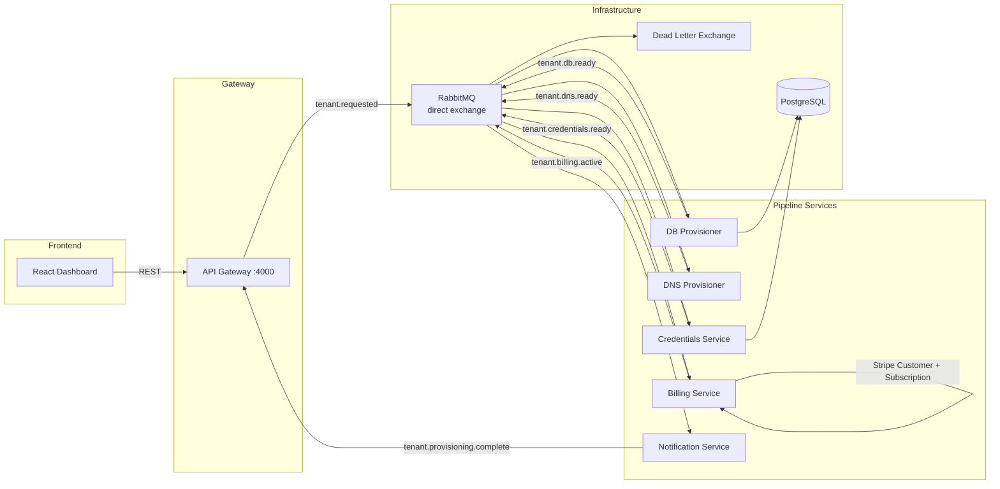
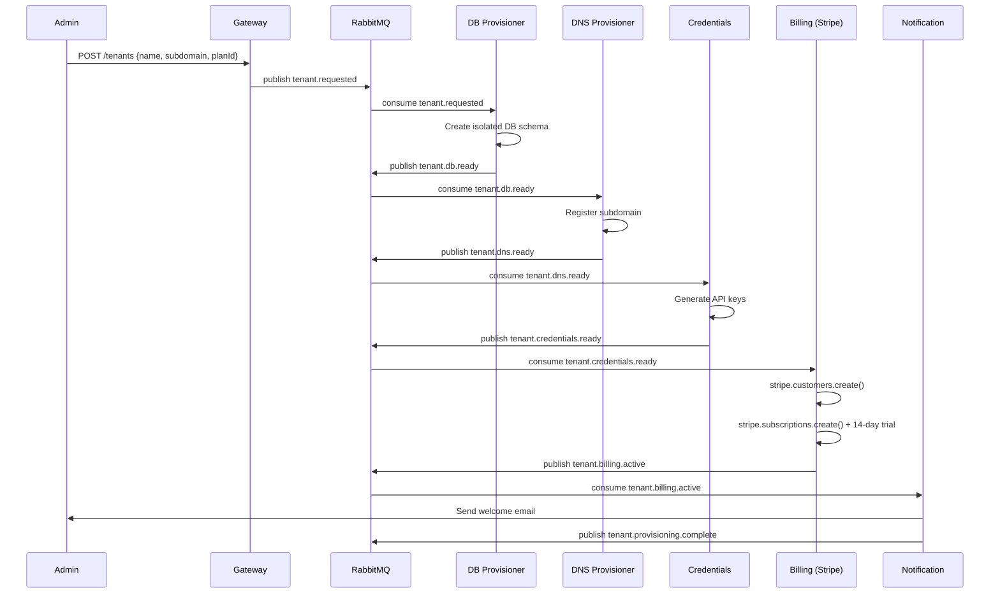
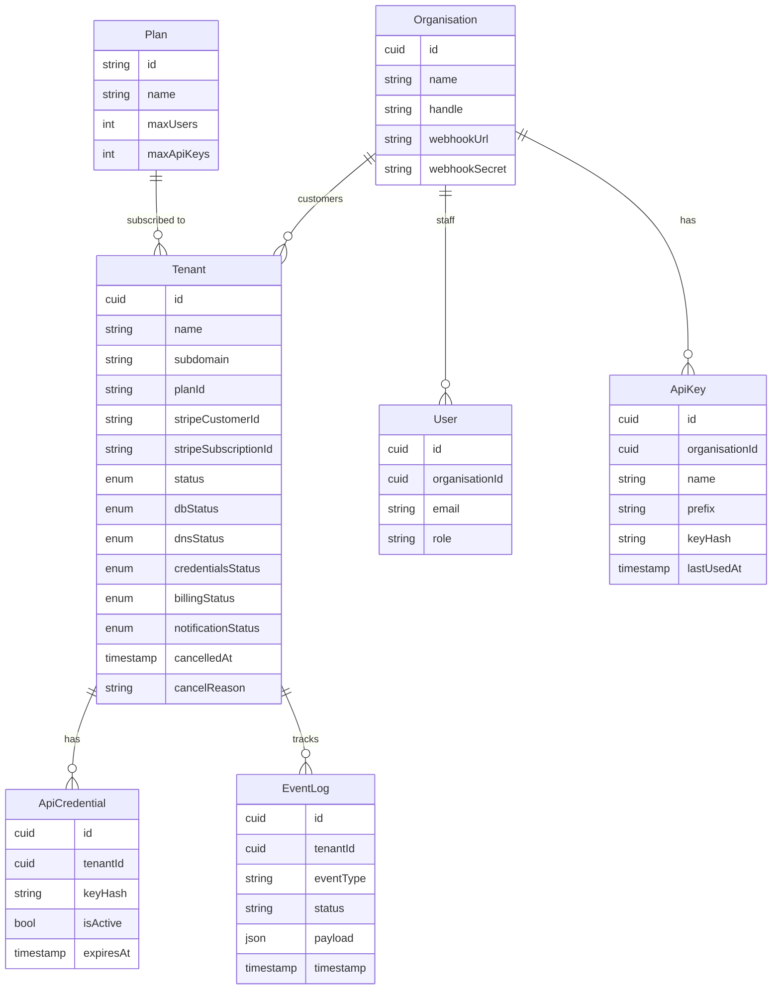

# TenantOps — Multi-Tenant SaaS Provisioning Platform

[](https://github.com/Olayanju-1234/liftoff/actions/workflows/ci.yml)

A production-grade microservices platform that automates the full lifecycle of tenant provisioning through an event-driven pipeline. Built to demonstrate distributed systems design, Stripe billing integration, and choreography-based saga patterns.

**Who it is for:** a SaaS company signs up as an **organisation**. Its customers are the **tenants** it provisions, by hand from the dashboard or from its own backend with a **company API key**. When a tenant is ready (or fails) Liftoff POSTs a signed **webhook** to the company. See [Integrate](#integrate).

**[Live dashboard](https://liftoff.ojusentinel.com)** · [API docs](https://api.liftoff.ojusentinel.com/api/docs) · all seven services, RabbitMQ and PostgreSQL on one 1-vCPU ARM VPS behind nginx

**At a glance:** 7 NestJS services · RabbitMQ choreography saga with a dead-letter exchange · schema-per-tenant PostgreSQL · Stripe customers and subscriptions with 14-day trials · stuck-pipeline sweeper · ADRs for the outbox pattern and Render vs AWS


## Table of Contents

- [System Architecture](#system-architecture)
- [Services](#services)
- [Event-Driven Pipeline](#event-driven-pipeline)
- [Data Model](#data-model)
- [Auth and Security](#auth-and-security)
- [API Reference](#api-reference)
- [Integrate](#integrate)
- [Getting Started](#getting-started)
- [Deployment](#deployment)
- [Engineering Decisions](#engineering-decisions)
- [Testing](#testing)
- [Roadmap and Known Gaps](#roadmap-and-known-gaps)

---

## System Architecture



---

## Services

| Service | Port | Description |
|---------|------|-------------|
| api-gateway | 4000 | Single entry point — rate limiting, routing, auth forwarding |
| tenant-service | 3001 | Core orchestration — tenant CRUD, pipeline state tracking |
| db-provisioner-service | 3002 | Creates isolated PostgreSQL schema per tenant |
| credentials-service | 3003 | Generates and stores API keys per tenant |
| dns-provisioner-service | 3004 | Registers subdomain DNS records |
| billing-service | 3005 | Creates Stripe customer and subscription with 14-day trial |
| notification-service | 3006 | Sends welcome email and publishes provisioning.complete |

### API Gateway

Single entry point for all client requests. Applies rate limiting (100 req/min per IP, stricter on auth routes), logs all traffic via Pino, and proxies to downstream services.

### Tenant Service

Core orchestration service. Manages the provisioning state machine and subscribes to all pipeline events to keep per-step status accurate. It also consumes the dead-letter exchange: a rejected step marks that step and the tenant `FAILED`. Runs a scheduled job every 5 minutes to auto-cancel pipelines stuck for more than 30 minutes.

Provisioning states: `PROVISIONING → ACTIVE | FAILED | CANCELLED`

Step statuses: `PENDING → IN_PROGRESS → SUCCESS | FAILED | CANCELLED`

Steps never move backwards. Each worker consumes its event in parallel with tenant-service, so a step can finish before tenant-service records its start. tenant-service therefore marks a step `IN_PROGRESS` only while it is still `PENDING`.

### Billing Service

Subscribes to `tenant.credentials.ready`. Validates Stripe Price IDs at startup (fails fast if any env var is missing). Creates a Stripe Customer and Subscription with a 14-day trial, then publishes `tenant.billing.active` with the real Stripe IDs.

---

## Event-Driven Pipeline



### Message Broker Configuration

- Exchange: `provisioning.direct` (direct, durable)
- Dead letter exchange: `dlx.provisioning` (durable)
- Each worker queue dead-letters to `dlx.provisioning` with its own key (`db-provisioner.failed`, `billing.failed`, …)
- tenant-service binds two durable queues to every key: `provisioning.dead-letters`, an unconsumed parking lot for inspection and replay, and its own consumer queue, which marks the step and tenant `FAILED`. See [docs/dead-letters.md](docs/dead-letters.md)
- `prefetchCount: 10` on all consumers

### Shared Event Types

Defined in `packages/shared-types` and consumed by all services:

```typescript
interface TenantRequestedPayload   { tenantId; subdomain; planId }
interface TenantDbReadyPayload     { tenantId; subdomain; planId }
interface TenantDnsReadyPayload    { tenantId; subdomain; planId }
interface TenantCredentialsReadyPayload { tenantId; subdomain; planId }
interface TenantBillingActivePayload {
  tenantId; subdomain; planId;
  stripeCustomerId; stripeSubscriptionId;
  subscriptionStatus; trialEnd: string | null;
}
interface ProvisioningCompletePayload { tenantId; subdomain }
```

---

## Data Model



---

## Auth and Security

- JWT with `sub`, `email`, `role`, `organisationId` claims (plus a legacy `tenantId`)
- Company API keys: `lk_…`, 32 random bytes, stored as a SHA-256 hash, shown once
- Webhooks signed with HMAC-SHA256; destinations resolved and checked against private, loopback, link-local and metadata ranges on every delivery
- bcrypt password hashing
- Single-use refresh token rotation
- Rate limiting per IP at gateway level
- CORS with configurable origin whitelist
- Helmet security headers
- `class-validator` decorators on all DTOs

```typescript
// JWT payload shape
{
  sub: string;       // user ID
  email: string;
  role: 'ADMIN' | 'USER';
  organisationId: string | null;
  tenantId: string | null; // legacy workspace tenant; null for new accounts
}
```

---

## OpenAPI

Both `api-gateway` and `tenant-service` expose interactive Swagger UI at
`/api/docs` (e.g. `http://localhost:4000/api/docs`). The spec is generated
from `class-validator` decorators on the shared DTOs in
`packages/shared-types`, so request schemas stay in lockstep with runtime
validation.

## API Reference

### Auth

| Method | Endpoint | Description |
|--------|----------|-------------|
| POST | `/auth/register` | Sign a company up: creates the admin user and their organisation (`companyName`, `handle`). Provisions nothing |
| POST | `/auth/login` | Login and receive tokens |
| POST | `/auth/refresh` | Refresh access token |
| POST | `/auth/logout` | Invalidate refresh token |
| GET | `/auth/me` | Get current user |

### Organisation and API keys

The organisation is the company that signed up. Every user in it sees the same tenants and keys.

| Method | Endpoint | Description |
|--------|----------|-------------|
| GET | `/organisation` | Name, handle, `webhookUrl` and whether a signing secret exists |
| PUT | `/organisation` | Update `name` or `webhookUrl`. A new URL (or `rotateWebhookSecret: true`) returns `webhookSecret` once; `webhookUrl: null` turns deliveries off. Private and loopback URLs get 400 |
| POST | `/api-keys` | Create a key (`name`). The response is the only place the key appears |
| GET | `/api-keys` | List keys: id, name, prefix, last use. Never the key |
| DELETE | `/api-keys/:id` | Revoke a key (204) |

### Tenants

Tenants are the organisation's customers. `POST /tenants` files the new tenant under the caller's organisation (and records the user who clicked, when there is one). Every tenant endpoint only returns or changes that organisation's tenants: another company's tenant answers 404, so its ID can't be probed.

`POST /tenants` and `GET /tenants/:id` also accept a company API key, as `x-api-key: <key>` or `Authorization: Bearer <key>`. Every other route needs a signed-in user.

| Method | Endpoint | Description |
|--------|----------|-------------|
| GET | `/tenants` | List the organisation's tenants |
| POST | `/tenants` | Create tenant and start provisioning (user token or API key; 10/min per IP). Send an `Idempotency-Key` header to make retries safe: the first response is stored per organisation for 24 h and replayed on a repeat (`Idempotent-Replayed: true`); the same key with a different body gets 422 |
| GET | `/tenants/:id` | Get tenant with step statuses (user token or API key; 60/min per IP) |
| DELETE | `/tenants/:id` | Delete tenant and clean up resources |
| POST | `/tenants/:id/cancel` | Cancel in-progress provisioning |
| GET | `/tenants/:id/events` | Get event log for tenant |
| GET | `/events` | Event log across the organisation's tenants |

### Settings

Settings belong to the caller. A new email doesn't replace the sign-in email right away: it is held as `pendingEmail`, and a link is sent to the new address. The sign-in email changes when that link is opened, within 24 hours. With no email provider configured nothing is sent, so the change is refused with a 503 instead of waiting on a link nobody received.

| Method | Endpoint | Description |
|--------|----------|-------------|
| GET | `/settings` | Get the caller's profile, notification settings and any pending email |
| PUT | `/settings` | Update them; a new email waits for confirmation, and one another account uses gets 409 |
| POST | `/settings/email/confirm` | Confirm a pending email with the token from the link (no auth; the token is the proof) |


---

## Integrate

Three steps take a SaaS company from signup to a provisioned customer with no dashboard clicks. The examples use the live gateway; swap in `http://localhost:4000` locally.

**1. Create a key.** Sign in on the dashboard (or `POST /auth/login`), then:

```bash
curl -s https://api.liftoff.ojusentinel.com/api-keys \
  -H "Authorization: Bearer $ACCESS_TOKEN" \
  -H 'Content-Type: application/json' \
  -d '{"name":"backend"}'
# {"id":"…","name":"backend","prefix":"lk_3fK9aQ2x","key":"lk_3fK9aQ2x…","lastUsedAt":null,"createdAt":"…"}
```

Store `key`; it is not shown again. `GET /api-keys` lists prefixes only.

**2. Provision a customer.** The key stands in for a user on `POST /tenants` and `GET /tenants/:id`:

```bash
curl -s -X POST https://api.liftoff.ojusentinel.com/tenants \
  -H "x-api-key: $LIFTOFF_API_KEY" \
  -H 'Content-Type: application/json' \
  -H "Idempotency-Key: $SIGNUP_ID" \
  -d '{"name":"Globex","subdomain":"globex","planId":"starter"}'
# 202 {"id":"cmv…","status":"PROVISIONING","dbStatus":"IN_PROGRESS",…}
# Repeat the same request after a timeout: same 202 body back, with Idempotent-Replayed: true

curl -s https://api.liftoff.ojusentinel.com/tenants/cmv… -H "x-api-key: $LIFTOFF_API_KEY"
```

**3. Receive the webhook.** Give the organisation a URL once (as a signed-in user), and keep the secret it returns:

```bash
curl -s -X PUT https://api.liftoff.ojusentinel.com/organisation \
  -H "Authorization: Bearer $ACCESS_TOKEN" \
  -H 'Content-Type: application/json' \
  -d '{"webhookUrl":"https://api.globex-saas.com/liftoff/webhook"}'
# {…,"webhookUrl":"https://api.globex-saas.com/liftoff/webhook","webhookConfigured":true,"webhookSecret":"whsec_…"}
```

When a tenant reaches `ACTIVE` or `FAILED`, tenant-service POSTs JSON with these headers:

| Header | Value |
|---|---|
| `x-liftoff-event` | `tenant.active` or `tenant.failed` |
| `x-liftoff-delivery` | UUID, the same on every retry of one delivery |
| `x-liftoff-signature` | `sha256=` + hex HMAC-SHA256 of the raw body, keyed with your secret |

```json
{ "event": "tenant.active", "tenant": { "id": "cmv…", "name": "Globex", "subdomain": "globex", "status": "ACTIVE", "planId": "starter", "dbStatus": "SUCCESS", "…": "…" } }
```

Verify before trusting it (Node):

```js
const crypto = require('crypto');
const expected = 'sha256=' + crypto.createHmac('sha256', process.env.LIFTOFF_WEBHOOK_SECRET).update(rawBody).digest('hex');
const ok = expected.length === signature.length && crypto.timingSafeEqual(Buffer.from(expected), Buffer.from(signature));
```

Answer with any 2xx. A 5xx, timeout or network error is retried after 1 s, 5 s and 25 s (four attempts in all, 10 s each); a 4xx is not retried. Redirects are not followed. The URL's host is resolved on every attempt and must not point at a private, loopback, link-local or metadata address. Delivery never blocks the saga: failures are logged by tenant-service and the tenant's status is still the source of truth, so poll `GET /tenants/:id` if a webhook does not arrive. Rotate the secret with `PUT /organisation {"rotateWebhookSecret": true}`.

---

## Getting Started

### Prerequisites

- Node.js 20+
- Docker and Docker Compose

### Quick Start

```bash
git clone https://github.com/Olayanju-1234/liftoff.git
cd liftoff
npm install

# Start PostgreSQL and RabbitMQ
docker-compose up -d postgres_db rabbitmq

# Copy and fill env files for each service (.env files are gitignored)
for f in backend/*/.env.example frontend/.env.example; do cp -n "$f" "${f%.example}"; done

# Create tables and generate Prisma clients. All three share tenant_db:
# tenant-service owns the public schema, credentials-service owns credentials
# The seed also runs the backfills (tenant owners, then organisations); both are idempotent
cd backend/tenant-service && npx prisma db push && npx prisma db seed && cd ../..
cd backend/credentials-service && npx prisma db push && cd ../..
# db-provisioner-service owns no tables, so it only needs its client
cd backend/db-provisioner-service && npx prisma generate && cd ../..

# Start all services
npm run dev
```

### Running a Single Service

```bash
cd backend/billing-service && npm run start:dev
```

---

## Deployment

The live demo runs on a single 1-vCPU ARM VPS. Each service is a systemd unit
capped at 256 MB, RabbitMQ and PostgreSQL listen on localhost only, and nginx
terminates TLS, proxies the gateway and serves the built frontend. At idle the
whole platform, broker included, uses about 400 MB.

The Dockerfiles and the `render.yaml` at the repo root still work for a Render
deploy. `render.yaml` builds every service with `dockerContext: .` so the
Dockerfiles can resolve workspace dependencies.

### Why not AWS

For the current portfolio scope, one VPS (or Render, via `render.yaml`) is
enough; AWS would cost $50–80/mo for the seven-service footprint and add a day
of CDK/Terraform without changing any application code. Containers are
already multi-stage and non-root, so the migration target is "swap the
deploy target" rather than "rewrite the platform." The full AWS architecture
(ECS Fargate, RDS Multi-AZ, Amazon MQ, Secrets Manager, X-Ray) and concrete
migration steps are written up in
[`docs/adr/0002-deploy-target-render-vs-aws.md`](docs/adr/0002-deploy-target-render-vs-aws.md).

### Environment Variables per Service

**All services:**
- `NODE_ENV`, `PORT`, `RABBITMQ_URL`

**Tenant Service, DB Provisioner, Credentials Service:**
- `DATABASE_URL` (PostgreSQL connection string). All three use the same
  database. tenant-service manages the `public` schema and credentials-service
  the `credentials` schema (pinned in its `schema.prisma`). db-provisioner-service
  manages no tables; it only creates a `tenant_<subdomain>` schema per tenant.

**Billing Service (optional Stripe):**
- `STRIPE_SECRET_KEY`, `STRIPE_PRICE_STARTER`, `STRIPE_PRICE_PRO`, `STRIPE_PRICE_ENTERPRISE`
  (without a key, subscriptions are simulated so the saga still completes, like DNS provisioning)

**Tenant Service (optional email):**
- `RESEND_API_KEY` (preferred), else `SENDGRID_API_KEY`, plus `EMAIL_FROM` (`noreply@…` or `Name <noreply@…>`). With neither key nothing is sent, and the log records only the recipient and subject, never the body or its links.

**Notification Service:**
- No extra variables; its welcome-email step is a mock

---

## Engineering Decisions

### Choreography-based saga (not orchestration)

Each service reacts to events independently rather than a central orchestrator directing the flow. This means:
- No single point of failure in the pipeline
- Services can be deployed and scaled independently
- Adding a new pipeline step only requires publishing a new event type

### RabbitMQ over Kafka

Direct exchange routing is sufficient at this scale. RabbitMQ's at-least-once delivery with acknowledgments, dead letter queues, and simpler operational profile made it the right choice for a task-queue workload.

### Billing service fails fast on startup

`buildPlanPriceMap()` validates all Stripe Price ID environment variables at module load time. If any are missing, the service refuses to start. This prevents the scenario where a subscription is attempted with an empty price ID, which would throw a Stripe API error at the worst possible moment (mid-provisioning, after the customer was already created).

### Database-per-tenant via schema isolation

Each tenant gets an isolated PostgreSQL schema rather than shared tables. This prevents data leakage between tenants, simplifies backup/restore per tenant, and allows per-tenant migrations without affecting others.

### Strict configuration validation at startup

Every service runs a Joi schema (`config/env.validation.ts`) over `process.env`
before the Nest container boots. Required values like `DATABASE_URL`,
`RABBITMQ_URL`, `JWT_SECRET`, and `JWT_REFRESH_SECRET` must be present and well
formed. JWT secrets must be at least 32 chars. Missing or malformed config
crashes boot with a single actionable error instead of producing 5xxs in
production at the worst possible moment.

`auth.service` correspondingly uses `configService.getOrThrow()` rather than
`get(...) || 'default'` fallbacks for any cryptographic secret — there are no
silent fallbacks to a known-weak value anywhere in the code path.

### Shared DTOs in `packages/shared-types`

All HTTP-facing DTOs live in a single workspace package and are imported by
both the gateway and the tenant service. One source of truth for the request
contract, one set of `class-validator` rules, one set of `@nestjs/swagger`
annotations, no drift.

---

## Testing

Unit tests cover the saga's brain — `auth.service` and `tenants.service` —
with the database, JWT signer, and RabbitMQ connection all mocked, plus the
organisation layer: API keys (hash-only storage, 401 on unknown or revoked
keys, the guard's key-vs-JWT routing), organisation scoping (another company's
tenant is a 404; the legacy workspace tenant is hidden), webhook signing,
retry and backoff, the private-address block including DNS rebinding, and the
organisation backfill's idempotence. Tests focus on:

- State transitions (saga step advancement, `PROVISIONING → ACTIVE`)
- Error semantics (`ConflictException`, `NotFoundException`,
  `BadRequestException`, `UnauthorizedException`)
- Security invariants (refresh tokens stored hashed, no existence-leak on
  unknown emails, no plaintext secrets in DB writes)
- Ordering invariants (e.g. `tenant.deleted` is published *before* the row
  is removed, so consumers can still read tenant context)
- Prisma error translation (`P2002` → `ConflictException`)

The API gateway's specs cover the proxy layer: method, path and body per
route, verbatim forwarding of the caller's bearer token, and error mapping
(downstream 4xx passed through, 5xx and network failures surfaced as 503).
Its e2e suite boots the real module on Fastify with tenant-service stubbed.

Each of the five workers has a spec that pins its RabbitMQ contract, with
Prisma, Stripe and the AMQP connection mocked: the queue and routing key it
binds, the event it publishes next, and a nack without requeue (so the
message dead-letters) when a step fails. Beyond that:

- db-provisioner reduces the subdomain to `[A-Za-z0-9_]` before it reaches
  the raw `CREATE SCHEMA`
- credentials republishes on a duplicate key (`P2002`) instead of failing,
  so redeliveries are idempotent
- billing refuses to boot without a price ID for every plan, and starts a
  14-day trial on the plan's price

```bash
npm run lint && npm run build && npm test
npm run test:e2e --workspace=api-gateway
# tenant-service 215 · api-gateway 24 (+20 e2e) · billing 16 · credentials 6
# db-provisioner 5 · dns-provisioner 3 · notification 3
```

The three Prisma services (tenant, credentials, db-provisioner) generate their
client before `build`, `lint` and `test`, so none of these need a database or a
`.env` file. [CI](.github/workflows/ci.yml) runs lint, build and test for every
service on each pull request and push to `main`.

---

## Roadmap and Known Gaps

These are the items that would come next if I were continuing on this codebase.
Calling them out explicitly because senior engineering is as much about knowing
where the cracks are as it is about the code that ships.

- **Transactional outbox for event publication.** Today the DB write and the
  RabbitMQ publish are not atomic — a process crash between them leaves the
  saga stuck until the 30-min timeout sweep. Design captured in
  [`docs/adr/0001-outbox-pattern.md`](docs/adr/0001-outbox-pattern.md).
- **Idempotency keys on saga handlers.** RabbitMQ guarantees at-least-once
  delivery; consumers should dedupe on `(tenantId, eventType)` rather than
  trusting that a duplicate redelivery will be a no-op.
- **OpenTelemetry tracing.** Add an OTel collector and propagate trace
  context across the RabbitMQ message headers. The current Pino logs are
  great per-service but stitching a single tenant's pipeline together
  across six services is manual.
- **Contract tests** (Pact or schema-snapshot) between producers and
  consumers of every RabbitMQ event, so a payload field rename can't ship
  without updating downstream consumers.
- **API gateway → tenant-service auth propagation.** Currently the gateway
  forwards the user's bearer token verbatim. Long-term, mint a short-lived
  service-to-service JWT signed by the gateway so downstream services can
  trust origin without re-validating the user token on every hop.
- **Per-tenant rate limiting.** The throttler is currently per-IP; per-tenant
  quotas (especially on the `POST /tenants` endpoint) would prevent one
  noisy customer from monopolizing pipeline capacity.
- **Schema migrations as a deploy artifact.** Today there are no committed
  migrations: tenant-service and credentials-service run `prisma db push`
  against their own schema on boot. Production needs a separate
  `prisma migrate deploy` job that runs once per release before the new
  service version takes traffic.
